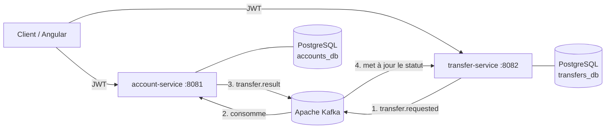
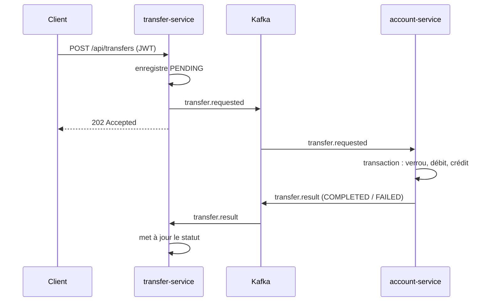

# 🏦 Banking Platform — microservices événementiels

Plateforme bancaire simplifiée construite en **architecture microservices** : ouverture de compte, authentification JWT et **virements asynchrones orchestrés par Apache Kafka**, avec garanties de cohérence (transactions, verrouillage, idempotence).

    

## Architecture



| Service | Rôle | Base |
|---|---|---|
| **account-service** | Inscription / connexion, émission des JWT, comptes et soldes, exécution des mouvements d'argent | `accounts_db` |
| **transfer-service** | Création des virements, historique, suivi du statut (`PENDING → COMPLETED / FAILED`) | `transfers_db` |

Chaque service possède **sa propre base** (pattern *database per service*) : ils ne communiquent que par API REST et événements Kafka.

## Déroulement d'un virement



## Choix techniques (et pourquoi)

- **Communication asynchrone (Kafka)** : `transfer-service` répond immédiatement (`202 Accepted`) et reste disponible même si `account-service` est momentanément indisponible ; les messages sont traités à son retour.
- **Atomicité** : débit et crédit se font dans **une seule transaction** PostgreSQL. Soit les deux passent, soit aucun.
- **Concurrence** : verrou pessimiste (`SELECT … FOR UPDATE`) sur les comptes, toujours pris **dans le même ordre** pour éviter les deadlocks. Contrainte `CHECK (balance >= 0)` en dernier filet de sécurité.
- **Idempotence** : Kafka livre « au moins une fois ». Chaque virement traité est mémorisé (`processed_transfer`) : une relivraison republie le résultat **sans jamais redébiter**.
- **Ordre garanti** : les événements sont partitionnés par compte source, donc les virements d'un même compte sont traités dans l'ordre.
- **Sécurité** : JWT HS256 émis par `account-service`, vérifiés par les deux services (Spring Security Resource Server). Le compte débité est lu **dans le token**, jamais dans la requête : impossible de débiter le compte d'un autre.
- **Montants** en `BigDecimal` / `NUMERIC(19,2)` (jamais de `double` pour de l'argent).
- **Migrations versionnées** avec Flyway, erreurs au format standard **RFC 7807** (`ProblemDetail`), métriques Prometheus via Actuator.

## Lancer le projet

Prérequis : Docker.

```bash
cp .env.example .env          # puis mets un vrai secret
docker compose up -d --build
./scripts/demo.sh             # scénario complet (nécessite curl et jq)
```

| URL | Contenu |
|---|---|
| http://localhost:8081/swagger-ui.html | API account-service |
| http://localhost:8082/swagger-ui.html | API transfer-service |
| http://localhost:8090 | Kafka UI (voir les messages passer) |

## API

| Méthode | Endpoint | Description |
|---|---|---|
| `POST` | `/api/auth/register` | Crée un utilisateur + un compte (1000 € offerts pour la démo) |
| `POST` | `/api/auth/login` | Retourne un JWT |
| `GET` | `/api/accounts/me` | Solde et infos du compte connecté |
| `POST` | `/api/transfers` | Demande un virement (`202 Accepted`) |
| `GET` | `/api/transfers` | Historique (émis et reçus) |
| `GET` | `/api/transfers/{id}` | Statut d'un virement |

## Tests

```bash
mvn verify
```

Tests unitaires sur la logique métier : virement réussi, solde insuffisant, bénéficiaire inconnu, **idempotence en cas de double livraison**, transitions de statut. Pipeline CI GitHub Actions à chaque push.

## Feuille de route

- [x] Microservices Spring Boot + Kafka + PostgreSQL + JWT
- [x] Docker Compose, CI GitHub Actions
- [ ] Interface Angular (connexion, solde, virement, historique)
- [ ] Tests d'intégration avec Testcontainers (Kafka + PostgreSQL réels)
- [ ] Pattern **Transactional Outbox** pour garantir la publication des événements
- [ ] API Gateway (Spring Cloud Gateway) et supervision Prometheus + Grafana
- [ ] Déploiement Kubernetes (manifests / Helm) et infrastructure Terraform

## Auteur

**Ismael Cherif** — Développeur Full Stack Java / Angular, M2 Expert en Informatique et Systèmes d'Information (EPSI Paris).
