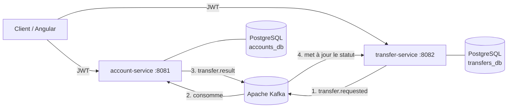
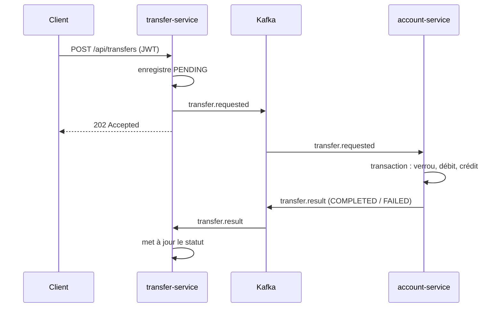

# 🏦 Banking Platform : microservices événementiels

Plateforme bancaire simplifiée construite en **architecture microservices** : ouverture de compte, authentification JWT et **virements asynchrones orchestrés par Apache Kafka**, avec garanties de cohérence (transactions, verrouillage, idempotence).

    

## Architecture



| Service | Rôle | Base |
|---|---|---|
| **account-service** | Inscription / connexion, émission des JWT, comptes et soldes, exécution des mouvements d'argent | `accounts_db` |
| **transfer-service** | Création des virements, historique, suivi du statut (`PENDING → COMPLETED / FAILED`) | `transfers_db` |

Chaque service possède **sa propre base** (pattern *database per service*) : ils ne communiquent que par API REST et événements Kafka.

## Déroulement d'un virement



## Choix techniques (et pourquoi)

- **Communication asynchrone (Kafka)** : `transfer-service` répond immédiatement (`202 Accepted`) et reste disponible même si `account-service` est momentanément indisponible ; les messages sont traités à son retour.
- **Atomicité** : débit et crédit se font dans **une seule transaction** PostgreSQL. Soit les deux passent, soit aucun.
- **Concurrence** : verrou pessimiste (`SELECT … FOR UPDATE`) sur les comptes, toujours pris **dans le même ordre** pour éviter les deadlocks. Contrainte `CHECK (balance >= 0)` en dernier filet de sécurité.
- **Idempotence** : Kafka livre « au moins une fois ». Chaque virement traité est mémorisé (`processed_transfer`) : une relivraison republie le résultat **sans jamais redébiter**.
- **Ordre garanti** : les événements sont partitionnés par compte source, donc les virements d'un même compte sont traités dans l'ordre.
- **Sécurité** : JWT HS256 émis par `account-service`, vérifiés par les deux services (Spring Security Resource Server). Le compte débité est lu **dans le token**, jamais dans la requête : impossible de débiter le compte d'un autre.
- **Montants** en `BigDecimal` / `NUMERIC(19,2)` (jamais de `double` pour de l'argent).
- **Migrations versionnées** avec Flyway, erreurs au format standard **RFC 7807** (`ProblemDetail`), métriques Prometheus via Actuator.

## Lancer le projet

Prérequis : Docker.

```bash
cp .env.example .env          # puis mets un vrai secret
docker compose up -d --build
./scripts/demo.sh             # scénario complet (nécessite curl et jq)
```

| URL | Contenu |
|---|---|
| http://localhost:4200 | **Interface Angular** (connexion, solde, virement, historique) |
| http://localhost:8081/swagger-ui.html | API account-service (bouton **Authorize** JWT) |
| http://localhost:8082/swagger-ui.html | API transfer-service (bouton **Authorize** JWT) |
| http://localhost:8091 | Kafka UI (voir les messages passer) |
| http://localhost:9091 | Prometheus (métriques scrappées) |
| http://localhost:3030 | Grafana : dashboard **ISMA BANK** (admin / admin) |

## API

| Méthode | Endpoint | Description |
|---|---|---|
| `POST` | `/api/auth/register` | Crée un utilisateur + un compte (50 000 € offerts pour la démo) |
| `POST` | `/api/auth/login` | Retourne un JWT (et horodate la connexion) |
| `PUT` | `/api/auth/password` | Change le mot de passe (vérifie l'ancien, BCrypt, 8 car. min), **authentifié** |
| `GET` | `/api/accounts/me` | Solde et infos du compte : titulaire, IBAN, date d'ouverture, dernière connexion |
| `POST` | `/api/transfers` | Demande un virement (`202 Accepted`) |
| `GET` | `/api/transfers` | Historique (émis et reçus) |
| `GET` | `/api/transfers/{id}` | Statut d'un virement |

## Frontend (Angular)

Interface **Angular 21** (composants standalone, signals, routing, SCSS) servie par **nginx**, dans `frontend/`.

- **Authentification** : pages connexion et inscription en colonne unique centrée (logo + carte, responsive). Connexion avec case « Se souvenir de mon identifiant » (seul l'e-mail est mémorisé en `localStorage`, jamais le mot de passe). Inscription avec confirmation du mot de passe et acceptation obligatoire des conditions d'utilisation. Attributs `autocomplete` conservés pour la proposition d'enregistrement du navigateur.
- **Pages** : tableau de bord (solde mis en avant + numéro de compte copiable, statut **Actif**, devise **Euro (€)**), virement et historique (badges de statut, sens émis/reçu, raison d'échec).
- **Mon compte** (menu + clic sur le nom en haut à droite) : profil (nom, e-mail masqué, date d'ouverture), **RIB** (titulaire, IBAN formaté par groupes de 4, BIC, copie de l'IBAN et **téléchargement du RIB en PDF généré côté navigateur, sans dépendance**), **sécurité** (changement de mot de passe + date de dernière connexion), plafonds (100 000 € par virement) et préférences (notifications e-mail, mémorisées localement).
- **Design system** : palette sobre « banque patrimoniale » (vert forêt + accent cuivre), contraste WCAG AA, tokens CSS dans `src/styles.scss`. L'adresse e-mail n'apparaît jamais en clair (masquée partout).
- **Suivi temps réel** : après un virement, l'app rafraîchit le statut jusqu'à ce qu'il quitte `PENDING`, puis met le solde à jour.
- **Sécurité** : `AuthService` (JWT en `localStorage`), intercepteur HTTP qui injecte le `Bearer`, déconnexion automatique sur `401`, guard sur les pages privées, erreurs backend (RFC 7807) affichées proprement.
- **Même origine** : nginx proxifie `/api/auth` et `/api/accounts` vers `account-service:8081`, `/api/transfers` vers `transfer-service:8082`, donc **aucun CORS**.

```bash
cd frontend
npm ci
npm start                     # dev sur http://localhost:4200 (proxy vers les API)
npm test -- --watch=false     # tests unitaires (Vitest, headless)
npm run build                 # build de production
```

> ⚠️ Angular 21 requiert **Node ≥ 22.12** (ou 20.19+/24+). Le build Docker utilise l'image `node:24-alpine`.

## Supervision (Prometheus + Grafana)

Chaque service expose ses métriques Micrometer sur `/actuator/prometheus`.

- **Prometheus** (http://localhost:9091) scrape `account-service` et `transfer-service` toutes les 5 s (`infra/prometheus/prometheus.yml`).
- **Grafana** (http://localhost:3030, **admin / admin**) est **provisionné automatiquement** (`infra/grafana/provisioning`) : datasource Prometheus + dashboard **ISMA BANK** prêt à l'emploi.
- Le dashboard affiche : requêtes HTTP/s par service, temps de réponse **p95**, taux d'erreurs **4xx/5xx**, mémoire **JVM** (heap), **threads**, et le **nombre de virements** par statut.
- Métrique métier : compteur Micrometer **`bank.transfers`** (tag `status` = `COMPLETED`/`FAILED`), incrémenté dans `transfer-service` à chaque virement finalisé.

> Ports hôte 9091/3030 choisis car 9090/3000 étaient déjà utilisés ; côté conteneur, Prometheus reste sur 9090 et Grafana sur 3000.

## Tests

```bash
mvn verify                              # backend (JDK 21 requis)
cd frontend && npm test -- --watch=false  # frontend (Vitest headless)
```

Backend : tests unitaires sur la logique métier : virement réussi, solde insuffisant, bénéficiaire inconnu, **idempotence en cas de double livraison**, transitions de statut, et **changement de mot de passe** (ancien mot de passe correct/incorrect, utilisateur inconnu).
Frontend : `AuthService`, intercepteur JWT, guard d'authentification, **confirmation et mémorisation de l'identifiant**, **formatage de l'IBAN** et masquage de l'e-mail.
Pipeline CI GitHub Actions (jobs **backend** + **frontend**) à chaque push.

## Feuille de route

- [x] Microservices Spring Boot + Kafka + PostgreSQL + JWT
- [x] Docker Compose, CI GitHub Actions
- [x] Interface Angular (connexion, solde, virement, historique)
- [ ] Tests d'intégration avec Testcontainers (Kafka + PostgreSQL réels)
- [ ] Pattern **Transactional Outbox** pour garantir la publication des événements
- [x] Supervision **Prometheus + Grafana** (dashboard ISMA BANK)
- [ ] API Gateway (Spring Cloud Gateway)
- [ ] Déploiement Kubernetes (manifests / Helm) et infrastructure Terraform

## Auteur

**Ismael Cherif**, Développeur Full Stack Java / Angular, M2 Expert en Informatique et Systèmes d'Information (EPSI Paris).
